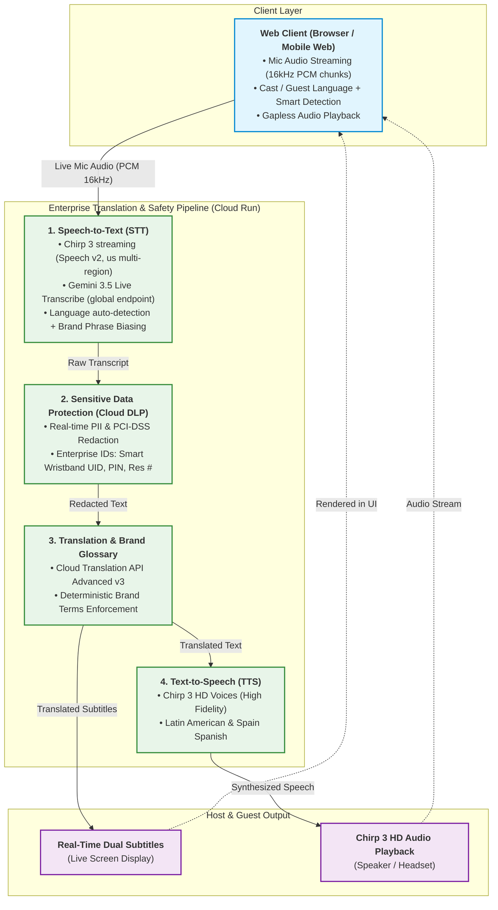
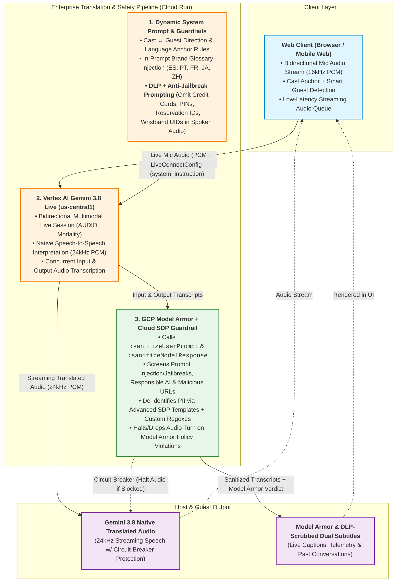

# Enterprise Live Translation POC (Google Cloud)

A production-ready, multi-container Proof of Concept (POC) evaluating **real-time live speech translation** for theme park & resort guest service hosts, hospitality personnel, and international guests, featuring **custom vocabulary and multi-language glossary injection** for brand terms, attraction names, and operations.

Powered by Google Cloud's enterprise stack. The default engine is a fully GA cascade: **Speech-to-Text v2 Chirp 3**, **Cloud Sensitive Data Protection (DLP)**, **Cloud Translation API Advanced v3**, and **Text-to-Speech Chirp 3 HD**. Gemini Live engines on the Gemini Enterprise Agent Platform (**Gemini 3.5 Transcribe**, **Gemini 3.5 Live Translate**, **Gemini 3.8 Live**) can be selected per session for comparison.

---

## Enterprise Production Pipeline Architecture

| Architecture Pillar | Enterprise Production Pipeline Specification |
| :--- | :--- |
| **Pipeline Nature** | **Modular Streaming Pipeline**: STT (Chirp 3) ➔ Cloud DLP ➔ MT v3 ➔ Chirp 3 HD TTS, or a Gemini Live speech-to-speech engine |
| **Language Model** | **Cast language anchor**: the cast member's language is fixed; the guest's language is selected or auto-detected (Smart Guest Language Detection) |
| **Speech-to-Text (STT)**| **Cloud Speech-to-Text v2 Chirp 3 streaming (multi-region `us`)** with Speech Adaptation (brand phrases, boost 20) and `language_codes=["auto"]` detection |
| **Data Protection & PII** | **Google Cloud Sensitive Data Protection (DLP)**: Real-time inline masking (PCI-DSS, Guest PII, Wristband UIDs, Security PINs) before translation and speech |
| **Brand Glossary** | **Deterministic Cloud Glossary** (CSV dictionary) + Multi-Language Catalog (ES, PT, FR, JA, ZH) |
| **Text-to-Speech (TTS)** | **Google Cloud Chirp 3 HD Voices** (e.g. `es-US-Chirp3-HD-Aoede` / `en-US-Chirp3-HD-Aoede`) |
| **Compliance & Readiness** | Default Chirp 3 cascade uses **GA APIs**; Gemini Live engines are preview models |
| **Primary Use Case** | **In-Park Host ↔ Guest Countertops, Kiosks & Mobile Web** |

---

## System Architecture

### 1. Modular Cascade Pipeline (`Chirp 3` / `Gemini 3.5 Transcribe` ➔ `Cloud DLP` ➔ `Translation v3` ➔ `Chirp 3 HD TTS`)



### 2. Gemini 3.8 Live Native Speech-to-Speech Architecture (with DLP Prompting + GCP Model Armor & Cloud SDP)



---

## Repository Structure

```
GCP-Live-Translation/
├── glossaries/
│   ├── enterprise_parks_glossary.json  # Structured multi-language terms, phonetics & rules
│   └── brand_glossary_en_es.csv        # Cloud Translation API Advanced CSV glossary (EN ➔ ES)
├── services/
│   ├── translation-pipeline/           # Core Service: Production Pipeline (FastAPI)
│   │   ├── main.py                     # FastAPI REST & WebSocket endpoints (/ws/stream-translate)
│   │   ├── live_workers.py             # Live engines: Chirp 3 streaming, Gemini 3.5 Transcribe, 3.5 Live Translate, 3.8 Live
│   │   ├── languages.py                # Language catalog (STT / Translation / TTS / Gemini codes)
│   │   ├── pipeline.py                 # Chirp 3 STT + Translation v3 + Chirp 3 HD TTS
│   │   ├── glossary_helper.py          # GCS & Translation API Glossary manager
│   │   ├── dlp_helper.py               # Cloud Sensitive Data Protection (DLP) manager
│   │   ├── Dockerfile
│   │   └── requirements.txt
│   └── web-client/                     # Core Service: Interactive Web & Mobile Simulator Testbed
│       ├── public/                     # HTML5, CSS, audio streaming client & Telemetry Terminal
│       ├── server.js                   # Node/Express API: glossary CRUD, saved conversations, upload proxy
│       └── Dockerfile
├── infra/
│   ├── deploy.sh                       # One-click Cloud Run multi-container deployment
│   ├── setup_glossary.sh               # Cloud Translation API Advanced glossary setup
│   └── start_proxy.sh                  # Local proxy & development runner
├── docker-compose.yml                  # Local development multi-container orchestration
└── .env.example                        # Template environment variables for custom GCP projects
```

> **Note on Native iOS App**: Experimental SwiftUI native client code is preserved on the dedicated [`ios-version`](https://github.com/John-Anthony-L/GCP-Live-Translation/tree/ios-version) git branch. The `main` branch is dedicated to the core web, pipeline, and containerized cloud services.

---

## Deployment to GCP (Cloud Run)

### Prerequisites
- Google Cloud SDK (`gcloud`) installed and authenticated (`gcloud auth login`).
- Active Google Cloud Project with billing enabled.

### 1-Click Cloud Run Deployment
Run the deployment script (optionally passing your own `PROJECT_ID`):
```bash
PROJECT_ID="your-gcp-project-id" ./infra/deploy.sh
```

The script will automatically:
1. Enable all required GCP APIs (`aiplatform`, `translate`, `speech`, `texttospeech`, `dlp`, `run`, `storage`, `artifactregistry`, `cloudbuild`).
2. Grant the Cloud Run runtime service account `roles/speech.client`, `roles/aiplatform.user`, `roles/cloudtranslate.user`, and `roles/dlp.user`.
3. Create the Cloud Storage glossary bucket `gs://${PROJECT_ID}-glossaries`.
4. Upload `brand_glossary_en_es.csv` and configure Translation API Advanced.
5. Build and deploy **Translation Pipeline** (configured with Chirp 3 Speech V2, Gemini 3.5/3.8 Live, Cloud DLP, and Chirp 3 HD TTS) and **Web Client** containers to Cloud Run in `us-central1`.
6. Output live Cloud Run service URLs.

---

## Testing the Live Translation POC

### Live 2-Way Translation Testbed (`http://localhost:3000`)
Open the deployed `live-web-client` Cloud Run URL (or `http://localhost:3000` when running locally) on desktop, tablet, or mobile browser:

1. **Set the languages**:
   - **Cast Language**: the language the cast member always speaks (the anchor). Every guest utterance is translated into it.
   - **Guest Language**: the guest's language. With Smart Detection on, this is only the starting language.
   - **Smart Guest Language Detection**: Chirp 3 (`language_codes=["auto"]`) or Gemini detects what the guest is speaking. A "Detected" badge appears, and from then on cast replies are translated into the detected language. The guest language only changes on utterances with 2+ words (or 2+ CJK characters), so short words like "OK" don't flip it.
   - Supported: 🇺🇸 English, 🇲🇽 Spanish (LatAm/US), 🇪🇸 Spanish (Spain), 🇧🇷 Portuguese, 🇫🇷 French, 🇩🇪 German, 🇮🇹 Italian, 🇯🇵 Japanese, 🇰🇷 Korean, 🇨🇳 Mandarin.
2. **Select a Translation Engine** (see the table below).
3. **Select Mode & Speak**:
   - **Cast Member / Guest Push-to-Talk**: hold a button while speaking; audio streams to the server as you talk.
   - **Continuous 2-Way Stream**: hands-free mode. The engine's endpointing splits utterances; utterances in the cast language are treated as the cast member, anything else as the guest. Not available for Gemini 3.5 Live Translate.
4. **Try Sample Phrases**:
   - *"Excuse me, where is the Lightning Lane entrance for Space Mountain?"*
   - *"Do I need a Virtual Queue for Star Wars: Rise of the Resistance?"*
   - *"My reservation number is RES-982341 and my PIN is 4821."* (With the Chirp 3 or Gemini Transcribe engines, DLP masks the reservation ID and PIN before translation and speech synthesis.)
5. **Recorded Upload tab**: upload a recorded conversation (WAV, MP3, M4A, ...). It is transcribed with Chirp 3 in 55-second windows, each utterance is routed with the same Cast / Guest routing, and you get a per-utterance transcript plus translated audio. Transcripts and audio can be downloaded and saved to **Past Conversations**.

### Translation Engines

| Engine | How it works | Push-to-talk | Continuous | Cloud DLP | Brand glossary |
| :--- | :--- | :---: | :---: | :--- | :--- |
| **Chirp 3** *(default)* | Speech-to-Text V2 (`chirp_3`, `us` multi-region) ➔ DLP ➔ Translation v3 ➔ Chirp 3 HD TTS | Yes | Yes | Before translation and speech | Translation v3 glossary + Speech Adaptation |
| **Gemini 3.5 Transcribe** | `gemini-3.5-transcribe-live-preview` (`global`) ➔ DLP ➔ Translation v3 ➔ Chirp 3 HD TTS | Yes | Yes | Before translation and speech | Translation v3 glossary + custom vocabulary |
| **Gemini 3.5 Live Translate** | `gemini-3.5-live-translate-preview` (`global`) speech-to-speech translation (paired `echo_target_language=False` sessions in 2-Way mode) | Yes | Yes | Spoken audio via system prompt + transcripts via Model Armor & Cloud DLP | Via system prompt + custom vocabulary |
| **Gemini 3.8 Live** | `gemini-3.8-live` (`us-central1`) speech-to-speech interpreter driven by a system prompt with the cast-anchor rules | Yes | Yes | Spoken audio via system prompt + transcripts via Model Armor & Cloud DLP | Via system prompt + custom vocabulary |

> [!NOTE]
> Because speech-to-speech engines generate translated audio directly inside the model, both **Gemini 3.5 Live Translate** and **Gemini 3.8 Live** enforce PII & safety protection using two layers: (1) dynamic **DLP & Model Armor rules injected into `system_instruction`** (`dlp_prompt(state)`) alongside `glossary_prompt`, and (2) deterministic **GCP Model Armor & Cloud DLP** screening/redaction on both input and output transcripts before display or storage (with a `model_armor_block` audio circuit-breaker). In Continuous 2-Way mode, **Gemini 3.5 Live Translate** runs paired Cast $\rightarrow$ Guest and Guest $\rightarrow$ Cast sessions with `echo_target_language=False` and hot-reconnects the Cast $\rightarrow$ Guest leg whenever Smart Guest Language Detection switches the guest language.

---

## Cloud Sensitive Data Protection (DLP) & Privacy Engine

The translation pipeline integrates **Google Cloud Sensitive Data Protection (DLP)** (`dlp_helper.py`) directly between Speech Recognition and Machine Translation. This ensures that no guest PII, payment info, or security PINs are ever logged, sent to external models, or spoken aloud in public areas.

### Supported InfoTypes Catalog

| InfoType Identifier | Category | Protected Information & Pattern | Default Mode |
| :--- | :--- | :--- | :---: |
| `CREDIT_CARD_NUMBER` | PCI Compliance | Visa, MasterCard, Amex, Discover card numbers & CVVs | **Active** |
| `PHONE_NUMBER` | Contact Info | US & International telephone and mobile numbers | **Active** |
| `EMAIL_ADDRESS` | Contact Info | Guest and Host personal & work email addresses | **Active** |
| `PERSON_NAME` | COPPA / Minors | Full names of guests, children, and family members | Optional (Kiosk) |
| `US_PASSPORT` | Government ID | Passport numbers, national ID cards, driver's licenses | **Active** |
| `RESERVATION_CONFIRMATION_ID` | Hospitality Custom | Resort, hotel, and booking confirmation numbers (`RES-982341`, `CONF-83921`) | **Active** |
| `SMART_WRISTBAND_UID` | Hospitality Custom | Smart wearable RFID / NFC serial numbers (`WB-A1B2C3D4`) | **Active** |
| `ACCOUNT_SECURITY_PIN` | Hospitality Custom | 4-to-6 digit security PINs used for guest verification & room access | **Active** |

### Deployment Presets

The Web Testbed and backend support dynamic preset modes depending on the operational context:
1. **Public Kiosk**: Enables all 8 privacy filters, including `PERSON_NAME` for strict COPPA / minor privacy compliance at self-service kiosks.
2. **Front Desk & Concierge** *(Default)*: Enforces PCI-DSS, passport, and custom hospitality identifiers while allowing guest names for warm, personalized greetings.
3. **Over-The-Phone Booking (Bypass)**: Temporarily bypasses redaction for authorized call-center agents who need to collect phone numbers and reservation IDs.

### Interactive DLP Sandbox
The Web Client features a dedicated **DLP Inspection & Redaction Sandbox** allowing operators to test custom phrases, inspect detection latency (typically < 35ms), and view granular entity match breakdowns in real time.

---

## Live Telemetry & Running Transcript Terminal

The Web Client includes a real-time **Telemetry Terminal** that monitors every hop of the live translation pipeline:
* **Mic Input**: Live RMS audio level meter while audio streams to the pipeline (muted while translated audio plays in continuous mode).
* **STT Capture**: Live interim and finalized transcripts with engine attribution, detected language and translation direction.
* **Cloud DLP**: Real-time redaction status indicating detected entities and sanitization latency.
* **Translation Engine**: Progressive translation output adhering to brand glossary rules.
* **TTS Speech**: Audio playback state and duration metrics.
* **Live Log Stream**: High-resolution event stream for debugging network latency, WebSocket boundaries, and payload sizes.

---

## API & WebSocket Endpoints Reference

### Service 1: Web Client & Management Server (Port 3000)

| Method | Endpoint | Description |
| :--- | :--- | :--- |
| `GET` | `/config.json` | Returns dynamic WebSocket URLs and backend proxy configuration |
| `GET` | `/api/conversations` | Lists all saved conversations with turn counts, timestamps, and language pairs |
| `GET` | `/api/conversations/:id` | Returns complete dialogue turns, original and translated text, and audio chunks |
| `POST` | `/api/conversations` | Saves a live or recorded conversation transcript and synthesized audio |
| `DELETE` | `/api/conversations/:id` | Deletes a conversation from persistent storage |
| `POST` | `/api/translate-audio-proxy` | Proxies recorded audio file translation payloads to the pipeline service |
| `GET` | `/api/glossary` | Retrieves current enterprise brand glossary terms and translations |
| `POST` | `/api/glossary/terms` | Adds or updates multi-language glossary definitions |
| `DELETE` | `/api/glossary/terms/:id` | Removes a term from the brand glossary |

### Service 2: Translation Pipeline (Port 8081)

| Method | Endpoint | Description |
| :--- | :--- | :--- |
| `GET` | `/health` | Healthcheck and active configuration status (project, location, models) |
| `GET` | `/api/languages` | Language catalog and available live engines |
| `GET` | `/api/dlp/catalog` | Returns the complete catalog of active and custom DLP InfoTypes |
| `POST` | `/api/dlp/sanitize` | Standalone endpoint to inspect and mask text against active DLP rules |
| `POST` | `/api/translate-text` | Translates text using Cloud Translation API Advanced v3 + Brand Glossary |
| `POST` | `/api/translate-audio` | Recorded conversation translation: Chirp 3 (Speech V2) or Gemini 3.5 per utterance with Cast / Guest routing (`cast_lang`, `guest_lang`, `smart_detect`), DLP, translation and TTS; returns per-utterance `segments` |
| `WS` | `/ws/stream-translate` | **Real-time bidirectional WebSocket** for live streaming (see protocol below) |
| `GET` | `/docs` | Interactive Swagger / OpenAPI documentation |

#### WebSocket protocol (`/ws/stream-translate`)

| Direction | Message | Purpose |
| :--- | :--- | :--- |
| Client ➔ Server | `config` | `castLang`, `guestLang`, `smartDetect`, `engine`, `voice`, `useDlp`, `dlpInfoTypes` (also accepts legacy `sourceLang`, `targetLang`, `sttModel`) |
| Client ➔ Server | `audio_stream_start` / `audio_chunk` / `audio_stream_end` | One streamed turn; `speakerRole` is `cast-member`, `guest` or `ambient` (continuous) |
| Client ➔ Server | `audio` | One-shot utterance (`{pcm, speakerRole, sourceLang, targetLang, sttModel}`) |
| Client ➔ Server | `text` | Typed turn |
| Server ➔ Client | `interim_transcript`, `stt_transcript`, `dlp_status`, `translation_text`, `interim_translation`, `audio` | Per-turn results, tagged with `turnId` |
| Server ➔ Client | `guest_language_detected` | Smart Detection switched the guest language |
| Server ➔ Client | `no_speech`, `turn_complete`, `error` | Status events |

---

## Getting Started with Your Own Google Cloud Project

To run this POC in your own GCP environment (without accessing any external project):

### 1. Prerequisites
* [Google Cloud SDK (`gcloud`)](https://cloud.google.com/sdk/docs/install) installed.
* [Docker Desktop](https://www.docker.com/products/docker-desktop/) or Docker engine.
* A GCP project with billing enabled.

### 2. Configure Environment Variables
Copy `.env.example` to `.env` in the repository root:
```bash
cp .env.example .env
```
Open `.env` and set `PROJECT_ID` to your Google Cloud project ID:
```env
PROJECT_ID=your-own-gcp-project-id
LOCATION=us-central1
CHIRP_REGION=us
GLOSSARY_ID=brand-parks-glossary-en-es
GLOSSARY_BUCKET=your-own-gcp-project-id-glossaries
```

### 3. Authenticate Google Cloud ADC
Ensure your local environment is authenticated to your project:
```bash
# Set active GCP project
gcloud config set project YOUR_PROJECT_ID

# Authenticate Application Default Credentials (ADC)
gcloud auth application-default login

# Enable required Google Cloud APIs
gcloud services enable \
  run.googleapis.com \
  speech.googleapis.com \
  translate.googleapis.com \
  texttospeech.googleapis.com \
  dlp.googleapis.com \
  aiplatform.googleapis.com \
  storage.googleapis.com
```

### 4. Run Locally with Docker Compose
```bash
docker compose up --build
```
* **Web Client & Management Dashboard:** `http://localhost:3000`
* **Translation Pipeline (Chirp 3 STT, DLP, MT v3, Chirp 3 HD TTS):** `http://localhost:8081` (API Docs: `http://localhost:8081/docs`)

---

## Brand Glossary & Multi-Language Management

The system preserves brand equity, attractions, and park terms using dual-layer enforcement across multiple target languages (**Spanish, Portuguese, French, Japanese, and Mandarin Chinese**):
1. **Recognition Biasing**: Brand phrases are injected into Chirp 3 Speech Adaptation (boost 20) and Gemini 3.5 Transcribe custom vocabulary.
2. **Cloud Translation API Advanced v3**: Deterministic CSV glossary mapping (Chirp 3 and Gemini 3.5 Transcribe engines).
3. **Gemini 3.8 Live**: Glossary terms are included in the system prompt. Gemini 3.5 Live Translate does not accept instructions, so the glossary is not applied there.

### Multi-Language View & Management via Web UI
In the web interface at `http://localhost:3000`:
1. Click on the **"Brand Glossary & Languages"** tab.
2. **View Covered Languages**: Each term independent card displays language chips (`ES`, `PT`, `FR`, `JA`, `ZH`) indicating which languages have localized translations.
3. **Filter by Language**: Use the **"View Language"** dropdown in the toolbar to focus on a specific language (e.g. Spanish, French, Japanese) or view all translations simultaneously.
4. **Add New Terms**: Click **"Add New Term"** to enter the English concept and translations for Spanish, Portuguese, French, Japanese, and Mandarin.
5. **Remove Terms**: Click the **"Remove"** button on any card to delete it from the active catalog and disk storage.

### Programmatic Glossary API
* **List All Terms:** `GET /api/glossary`
* **Add Multi-Language Term:** `POST /api/glossary/terms`
  ```json
  {
    "en": "Express Priority Pass",
    "category": "Service",
    "keep_original": true,
    "translations": {
      "es": "Pase de Prioridad Express",
      "pt": "Passe de Prioridade Express",
      "fr": "Passe Prioritaire Express",
      "ja": "エクスプレス・プライオリティ・パス",
      "zh": "特快优先通行证"
    },
    "notes": "VIP priority attraction queue pass"
  }
  ```
* **Delete Term:** `DELETE /api/glossary/terms/:termId`
* **Sync to Cloud Storage & Translation API:** `POST http://localhost:8081/api/glossary/sync`

---

## Environment Variables Reference

| Variable | Default Value | Description |
| :--- | :--- | :--- |
| `PROJECT_ID` | `your-gcp-project-id` | Your Google Cloud Project ID |
| `LOCATION` | `us-central1` | Primary GCP Region for Cloud Run, Translation v3, and DLP |
| `CHIRP_REGION` | `us` | Multi-region endpoint for Speech-to-Text v2 **Chirp 3** (`us` or `eu`) |
| `GLOSSARY_ID` | `brand-parks-glossary-en-es` | Cloud Translation API Advanced glossary resource ID |
| `GLOSSARY_BUCKET` | `[PROJECT_ID]-glossaries` | Cloud Storage bucket storing CSV glossaries |
| `GEMINI_TRANSCRIBE_MODEL` | `gemini-3.5-transcribe-live-preview` | Model for the Gemini 3.5 Transcribe engine |
| `GEMINI_TRANSCRIBE_LOCATION` | `global` | Endpoint location for Gemini 3.5 Transcribe (`global`) |
| `GEMINI_LIVE_TRANSLATE_MODEL` | `gemini-3.5-live-translate-preview` | Model for the Gemini 3.5 Live Translate engine |
| `GEMINI_LIVE_TRANSLATE_LOCATION` | `global` | Endpoint location for Gemini 3.5 Live Translate (`global`) |
| `GEMINI_LIVE_MODEL` | `gemini-3.8-live` | Model for the Gemini 3.8 Live engine |
| `GEMINI_LIVE_LOCATION` | `LOCATION` | Endpoint location for Gemini 3.8 Live (`us-central1`) |
| `USE_MODEL_ARMOR` | `true` | Enables GCP Model Armor (`:sanitizeUserPrompt` & `:sanitizeModelResponse`) screening |
| `MODEL_ARMOR_LOCATION` | `LOCATION` | Regional endpoint for GCP Model Armor (`us-central1`) |
| `MODEL_ARMOR_TEMPLATE_ID` | `live-translation-armor` | Default Model Armor template (PI/Jailbreak, RAI, Malicious URI + SDP) |
| `MODEL_ARMOR_COPPA_TEMPLATE_ID` | `live-translation-armor-coppa` | Kiosk/COPPA Model Armor template (adds `PERSON_NAME` de-identification) |
| `TRANSLATE_AUDIO_TIMEOUT_MS` | `300000` | Web client: timeout for recorded-upload translation requests |

---

## Changelog

See [`CHANGELOG.md`](CHANGELOG.md) for the full release history
